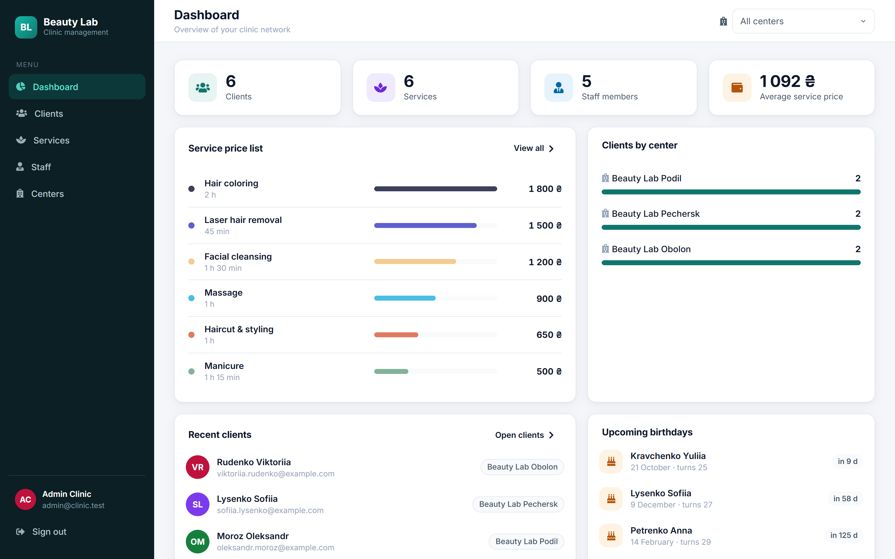
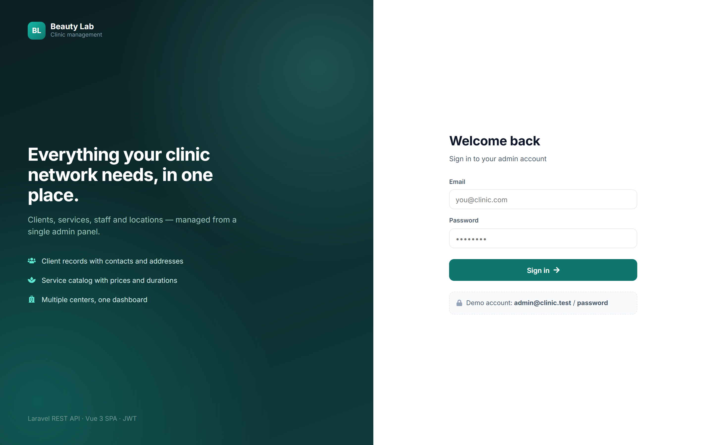
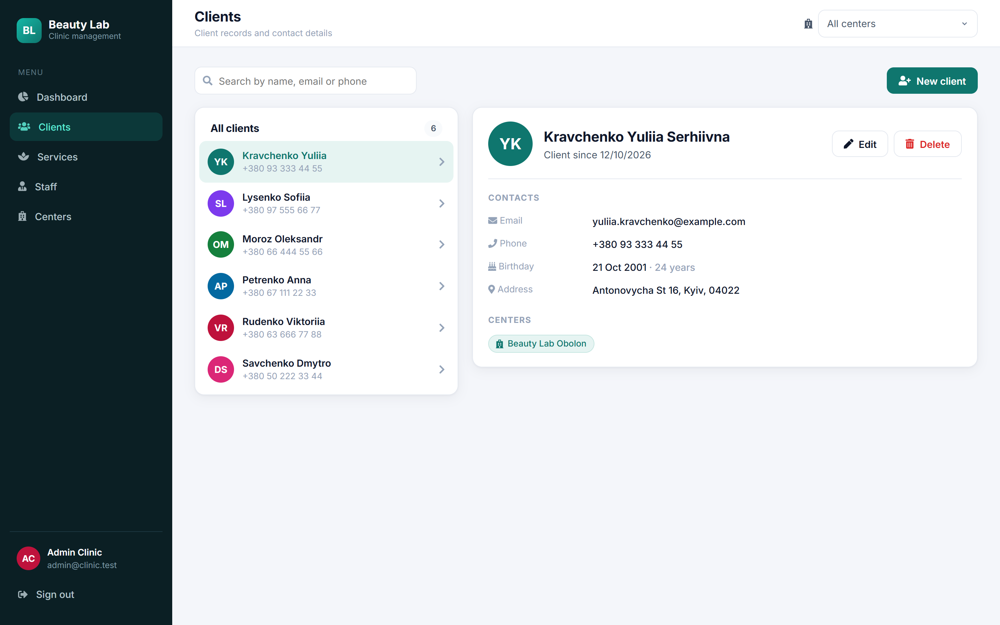
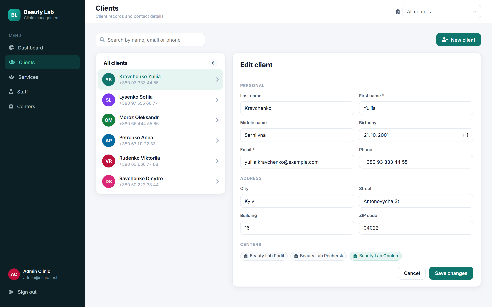
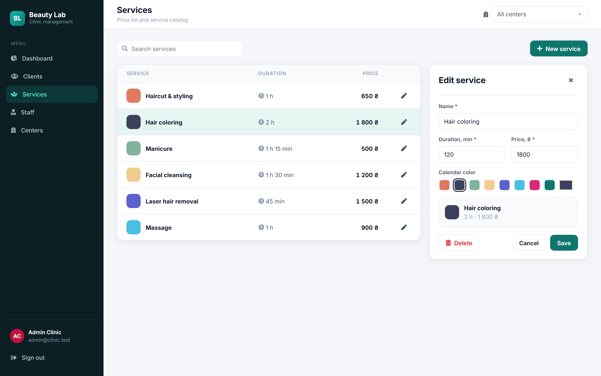
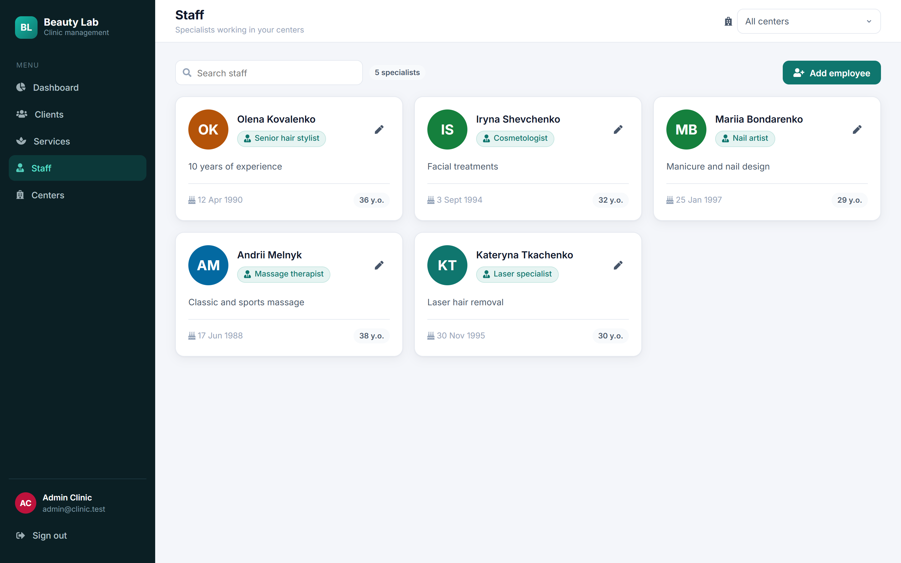
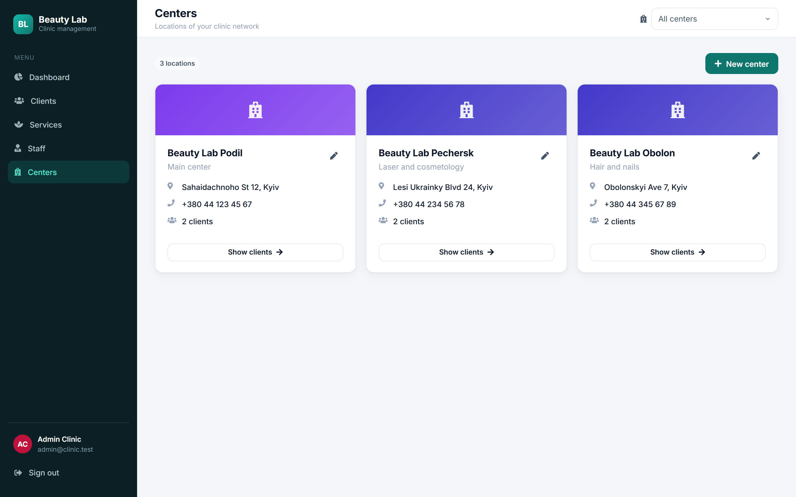

# Beauty Lab CRM — Clinic Management System

Admin panel for a network of beauty / medical clinics: **clients, services, staff and locations** in one place.
Full-stack project: **REST API on Laravel 8** + **single-page app on Vue 3**, JWT authentication.



## Features

- **Dashboard** — key numbers, service price chart, clients per center, recent clients and upcoming birthdays (all computed from live data)
- **Clients** — searchable list, client profile, create / edit / delete, address and center assignment
- **Services** — price list with durations and calendar colors, inline editor with live preview
- **Staff** — specialist cards, add / edit / delete in a modal
- **Centers** — locations with address, phone and client count; one click filters clients by center
- **Center switcher** in the top bar filters clients and dashboard stats across the whole app
- **JWT auth** — protected API routes, token attached by an Axios interceptor, automatic logout on `401`

## Screenshots

| | |
|---|---|
|  |  |
|  |  |
|  |  |

## Tech stack

| Layer | Technologies |
|---|---|
| Backend | PHP 8, Laravel 8, Eloquent ORM, tymon/jwt-auth, API Resources, migrations & seeders |
| Database | SQLite for the local demo (MySQL supported via `.env`) |
| Frontend | Vue 3, Vue Router 4, Vuex 4, Axios, Font Awesome, custom CSS design system (no UI framework) |
| Tooling | Vue CLI, Composer, PowerShell setup scripts, Playwright script for screenshots |

## Architecture

```
backend/                        Laravel REST API
  routes/api.php                login / register + JWT-protected resource routes
  app/Http/Controllers/         Users, Centers, Services, Collaborators (CRUD)
  app/Http/Resources/           JSON transformers ({ success, data, message } format)
  database/migrations/          users, addresses, centers, services, staff, roles, pivot tables
  database/seeders/             demo data: 3 centers, 6 services, 5 specialists, 6 clients

frontend/                       Vue 3 SPA
  src/services/resource.js      one generic REST client for every resource
  src/store/resource.module.js  one generic Vuex CRUD module with toast notifications
  src/components/pages/         Dashboard, Clients, Services, Staff, Centers
  src/css/app.css               design tokens + components

scripts/screenshots.mjs         takes the README screenshots with Playwright
```

In development the Vue dev server proxies `/api` to Laravel, so there are no CORS issues.

## Running locally (Windows)

Requirements: PHP 8.2 and Node.js LTS.

```powershell
winget install -e --id PHP.PHP.8.2
winget install -e --id OpenJS.NodeJS.LTS
# reopen the terminal, then in the project folder:
powershell -ExecutionPolicy Bypass -File .\setup.ps1   # Composer, .env, keys, database + demo data, npm install
.\run.ps1                                              # API on :8000, app on http://localhost:8081
```

Demo login: **admin@clinic.test / password**

<details>
<summary>macOS / Linux</summary>

```bash
cd backend
composer install
cp .env.example .env && touch database/database.sqlite
php artisan key:generate && php artisan jwt:secret
php artisan migrate --seed
php artisan serve

cd ../frontend
npm install --legacy-peer-deps
NODE_OPTIONS=--openssl-legacy-provider npm run serve
```
</details>

## History

Started in 2022 as a Laravel API + Vue SPA (the auth flow began from a public Vue 3 + JWT starter).
In 2026 I revived it: fixed broken migrations, controllers and auth, added demo data and a one-command setup,
and rebuilt the whole frontend with a new design.
